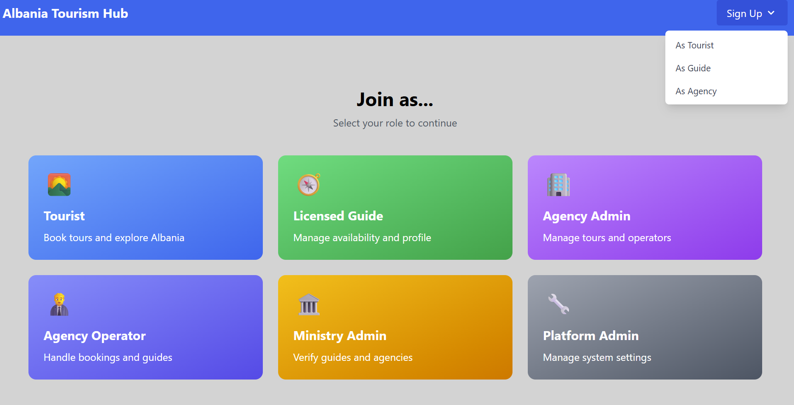
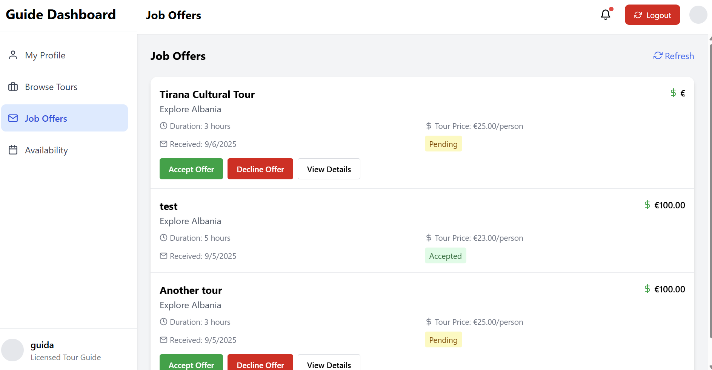
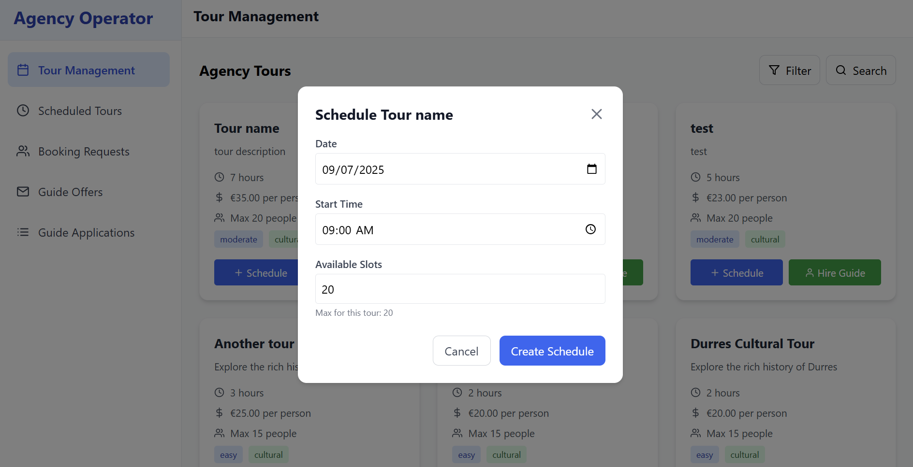
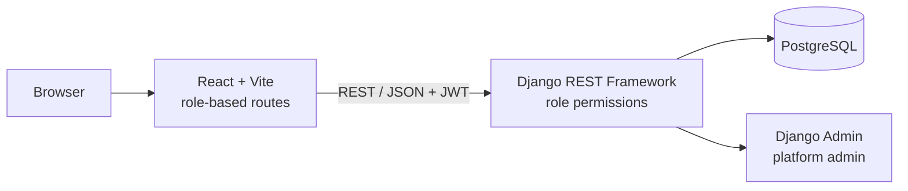
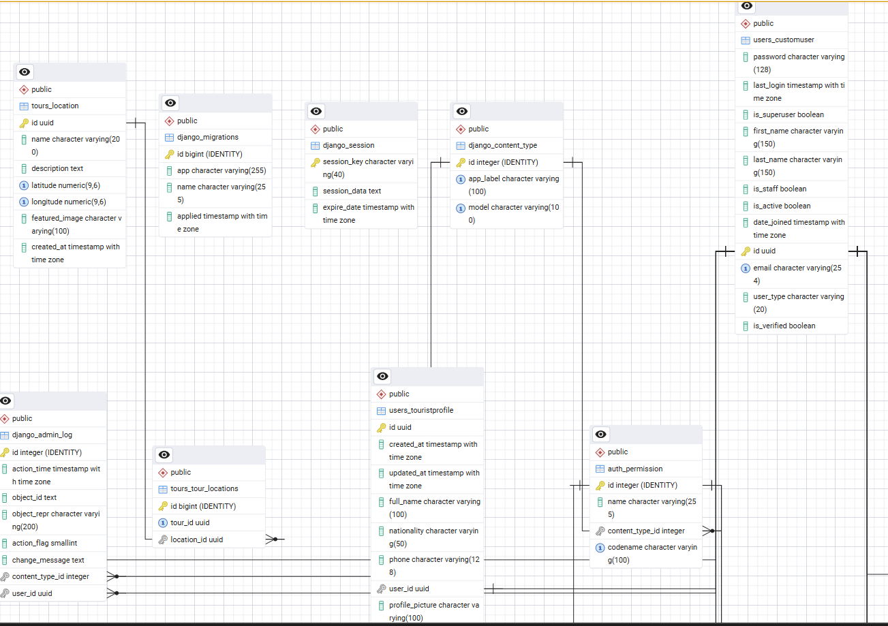

# Albania Tourism Hub

A web platform that brings tourists, licensed tour guides, travel agencies and the Ministry of Tourism into one system, so they don't have to coordinate through scattered websites, social media and phone calls.

Built as my **Bachelor's thesis in Software Engineering** at the Canadian Institute of Technology (Tirana, 2025). The written thesis covers the problem research, system design and database design, and is available on request.



## Features

The platform is built around **role-based access control** with six user types. Each one has its own registration flow, dashboard and API permissions:

| Role | What they can do |
|---|---|
| **Tourist** | Browse tours, book scheduled tours, leave reviews |
| **Licensed Guide** | Manage profile and availability, apply for tours, accept or decline job offers from agencies |
| **Agency Admin** | Register an agency, create tours, create and manage operator accounts |
| **Agency Operator** | Schedule tours, handle booking requests, hire guides and send offers |
| **Ministry Admin** | Verify guide licences and agency registrations; accounts stay inactive until approved |
| **Platform Admin** | System-wide management through the Django admin |

Other highlights:

- JWT authentication with refresh-token rotation and logout blacklisting
- Multi-step sign-up forms with document upload for guide/agency verification
- Role-based routing on the frontend (protected routes per user type)
- Dark mode

| Guide dashboard | Agency operator: tour scheduling |
|---|---|
|  |  |

## Tech stack

- **Backend:** Python, Django 5, Django REST Framework, Simple JWT
- **Frontend:** React 18, Vite, Tailwind CSS, React Router, Axios
- **Database:** PostgreSQL



## Project structure

```
backend/
  backend/      Django project settings and root URLs
  users/        Custom user model, 6 role profiles, registration, auth, verification, permissions
  tours/        Tours, schedules, bookings, reviews, guide offers and availability
frontend/
  src/pages/    One folder per role (Tourist, Guide, AgencyAdmin, AgencyOperator, Ministry, Platform)
  src/api/      API clients per role
  src/components/  Layouts, auth forms, shared UI
docs/           Screenshots and diagrams
```

## Getting started

### Prerequisites

- Python 3.11+
- Node.js 18+
- PostgreSQL

### Backend

```bash
cd backend
python -m venv venv
source venv/bin/activate          # Windows: venv\Scripts\activate
pip install -r ../requirements.txt

cp .env.example .env              # then fill in SECRET_KEY and your database credentials
createdb tourism_platformDB       # or create the database in pgAdmin

python manage.py migrate
python manage.py createsuperuser  # use user_type "admin" for the platform admin
python manage.py runserver
```

The API runs at `http://127.0.0.1:8000`.

### Frontend

```bash
cd frontend
npm install
npm run dev
```

The app runs at `http://localhost:5173` and proxies `/api` requests to the Django server.

### Running tests

```bash
cd backend
python manage.py test
```

## Database design



The full ER diagrams and design rationale are in chapter III of the thesis.

## Status and roadmap

This started as an MVP for the thesis and I've kept working on it since. Not done yet:

- Online payments (bookings are currently confirmed without payment)
- Ministry statistics and reporting (verification is the only finished ministry feature)
- Wider test coverage, especially for the `tours` app
- Deployment configuration

## License

[MIT](LICENSE) © Amar Baci
